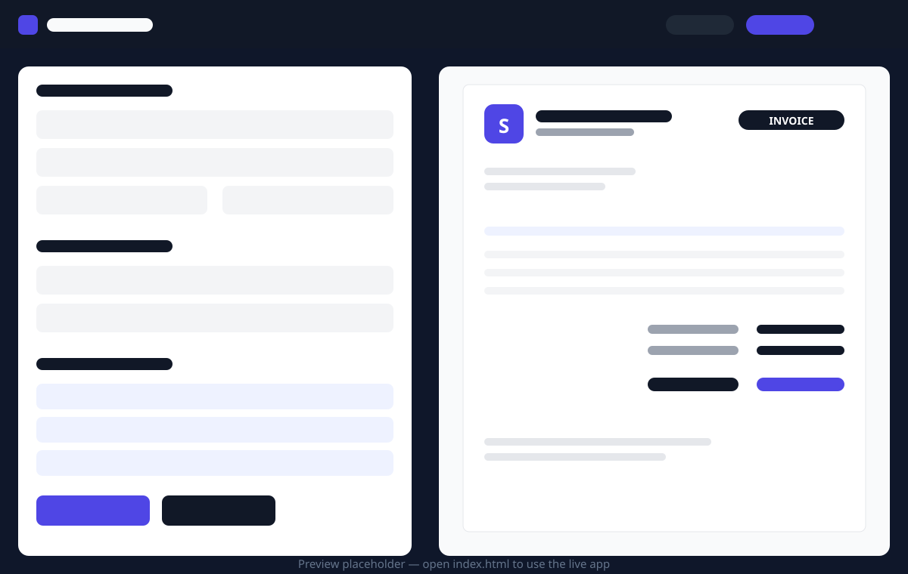

# InvoiceForge

**A free, open-source invoice generator for freelancers — built with plain HTML, CSS and vanilla JavaScript.**

Create professional invoices in your browser in minutes: add your business details, your client, and your line items, watch the A4 preview update live, then print or save a clean PDF. No sign-up, no server, no build step — and your data never leaves your device.



> The screenshot above is a placeholder preview graphic. Open `index.html` to use the live app.

## Features

- ✍️ **Full invoice editor** — business profile, client details, invoice number, issue and due dates
- 🔢 **Auto-increment invoice numbers** — `INV-0001`, `INV-0002`, … so you never reuse a number
- 🧾 **Unlimited line items** — add/remove rows with automatic per-line totals
- 🧮 **Live totals** — subtotal, percentage discount, Tax/VAT and grand total, calculated as you type (never `NaN`)
- 💱 **Multi-currency** — PKR, USD, EUR, GBP, AED and INR with correct symbols via `Intl.NumberFormat`
- 👀 **Live A4 preview** — a clean, print-ready invoice document beside the editor, updated on every keystroke
- 🏷️ **Status workflow** — Draft / Sent / Paid, shown as a colour-coded badge on the invoice
- 🖨️ **Print / Save as PDF** — a dedicated print stylesheet prints *only* the invoice, cleanly on A4
- 💾 **Saved invoices** — save, load, duplicate and delete invoices; your business profile persists between visits (all in `localStorage`)
- 🌙 **Dark / light mode** — toggle in the nav, remembered between visits
- ✅ **Input validation** — required fields highlighted, negative numbers rejected
- ♿ **Accessible** — semantic HTML5, labelled inputs, focus states, skip link, good contrast
- 🚀 **Zero dependencies** — no frameworks, no CDN, no build step; works offline from a `file://` URL
- 🎁 **Sample data on first run** — clearly labelled, so the preview looks complete immediately; edit or replace it all

## Tech stack

| Layer    | Technology                                      |
| -------- | ----------------------------------------------- |
| Markup   | Semantic HTML5                                  |
| Styling  | CSS3 with custom properties (variables), Flexbox & Grid |
| Logic    | Vanilla JavaScript (ES5-compatible patterns, IIFE module) |
| Storage  | Browser `localStorage`                          |
| Printing | CSS `@media print` + `@page` A4 rules           |

## Installation

There is nothing to install. Pick whichever way you prefer:

**Option 1 — just open it**

Download or clone the project and double-click `index.html`.

**Option 2 — clone with Git**

```bash
git clone https://github.com/your-username/invoiceforge.git
cd invoiceforge
```

Then open `index.html` in any modern browser.

**Option 3 — serve it locally (optional)**

```bash
# Python
python3 -m http.server 8000

# or Node
npx serve .
```

Then visit `http://localhost:8000`.

## How to use

1. **Your Business** — fill in your name/business, email, phone, address and a 1–2 letter logo initial. This profile is saved automatically and reused on every new invoice.
2. **Bill To** — add your client's name (required), company, email and address.
3. **Invoice Details** — check the auto-generated invoice number, set the issue and due dates, pick a currency and a status (Draft / Sent / Paid).
4. **Items** — describe each service or product, set quantity and rate. Use **+ Add Item** for more rows; totals update live.
5. **Totals & Notes** — optionally add a discount % and Tax/VAT %, plus your payment terms (bank details, due window, payment reference).
6. **Save Invoice** — stores the invoice in the **Saved Invoices** panel, where you can reload, duplicate or delete it later.
7. **Print / Save as PDF** — prints only the invoice document. In the print dialog, choose "Save as PDF" to download a PDF.

> **Data & privacy:** everything is stored in your browser's `localStorage` on your own device. Clearing your browser data will remove saved invoices — export important invoices to PDF for your records.

## Customization guide

All theming is done through CSS variables at the top of `assets/css/style.css` — no need to touch component styles.

```css
:root {
  --color-primary: #4f46e5;       /* buttons, links, invoice accents */
  --color-primary-hover: #4338ca;
  --color-accent: #7c3aed;        /* gradient partner colour */
  --color-bg: #f3f5fa;            /* page background (light mode) */
  --color-surface: #ffffff;       /* cards */
  --color-text: #111827;
  --font-sans: system-ui, ...;    /* typography */
  --radius: 12px;                 /* card corner radius */
}
```

- **Brand colour:** change `--color-primary` and `--color-accent` and the whole UI — including the invoice header rule and total — follows.
- **Dark mode:** dark-theme values live under `[data-theme="dark"]` in the same file.
- **Invoice document colours:** `--doc-*` variables control the printable document (kept light for clean printing).
- **Currencies:** add an `<option>` to the currency `<select>` in `index.html`; formatting is handled automatically by `Intl.NumberFormat`.
- **Default tax/discount:** edit the `blankState()` defaults in `assets/js/script.js`.

## Project structure

```
invoiceforge/
├── index.html                 # App markup (editor, live preview, saved invoices)
├── assets/
│   ├── css/
│   │   └── style.css          # All styles, CSS variables, responsive + print rules
│   ├── js/
│   │   └── script.js          # All application logic (vanilla JS, localStorage)
│   └── images/
│       ├── favicon.svg        # Favicon / brand mark
│       ├── og-image.svg       # Open Graph social card
│       └── preview.svg        # README preview graphic
├── README.md
├── LICENSE                    # MIT License
├── CONTRIBUTING.md
├── CHANGELOG.md
└── .gitignore
```

## Browser compatibility

InvoiceForge uses only evergreen web platform features (`localStorage`, `Intl.NumberFormat`, CSS custom properties, Flexbox/Grid, `@media print`) and works in:

- Google Chrome / Chromium (recent versions)
- Mozilla Firefox (recent versions)
- Microsoft Edge (recent versions)
- Apple Safari 14+

No Internet Explorer support — by design.

## Publishing your own copy on GitHub

1. Create a new empty repository on GitHub named `invoiceforge` (no README/license — this project already includes them).
2. From the project folder:
   ```bash
   git init
   git add .
   git commit -m "InvoiceForge v1.0.0 — initial release"
   git branch -M main
   git remote add origin https://github.com/your-username/invoiceforge.git
   git push -u origin main
   ```
3. *(Optional)* Enable **GitHub Pages** under *Settings → Pages → Deploy from branch (`main`, root)* to get a free live demo URL.

## Contributing

Contributions are welcome! Please read [CONTRIBUTING.md](CONTRIBUTING.md) for how to report bugs, propose features and submit pull requests.

## License

Released under the [MIT License](LICENSE).

Copyright (c) 2026 **Afzaal Ahmed**.

## Author

Created by **Afzaal Ahmed** — WordPress & Shopify developer. If InvoiceForge saves you time, consider giving the repository a ⭐ on GitHub.
